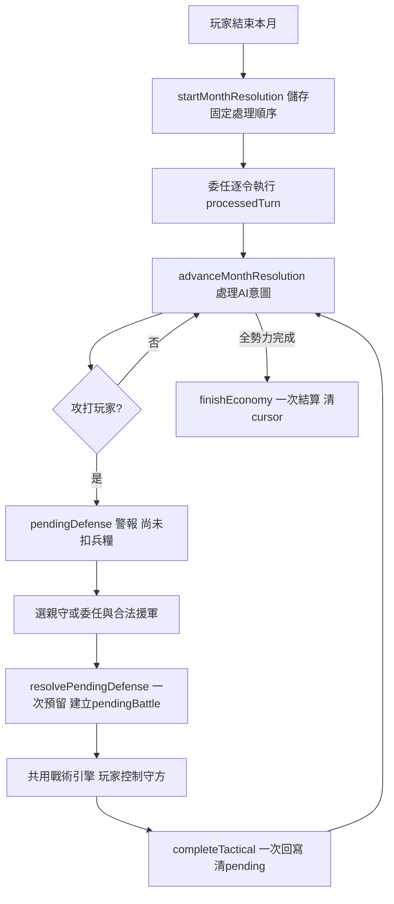

# 架構與驗證 V0.3.0

React 19、strict TypeScript、Vite 7、原生CSS/SVG、Vitest與Chromium。無後端及遊戲運行時網路依賴。`GameState`是唯一遊戲事實來源，UI不計算傷亡、不以動畫提交戰果。

## 資料驅動世界

- `data/scenario.ts`保留V0.2.3原12城／30將／3國的ID、開局及低階V2測試介面。
- `data/world/cities.ts`定義41城與雙向鄰接圖；`world/officers.ts`定義歷史姓名、可用年代、原創能力與特質。新人物ID由姓名Unicode碼點產生，新增別人不改動既有人物ID。
- `data/scenarios.ts`按scenarioId組裝194／214／legacy世界。城將模板、玩家可選勢力、地圖與存檔驗證共用此資料；新遊戲都使用V3。
- 勝利及UI數量依實際世界計算，不再假設12城。年代只影響新劇本人物篩選；舊檔不補城、不改原人物或位置。

## 主要規則

| 模組                                      | 責任                                                       |
| ----------------------------------------- | ---------------------------------------------------------- |
| `actions.ts`、`domestic.ts`、`balance.ts` | 內政與調動驗證、行動及成本、太守效率                       |
| `personnel.ts`                            | 搜尋、登用、賞賜、太守、忠誠、離任                         |
| `diplomacy.ts`                            | 雙邊關係、交涉成本／機率、條約／冷卻及宣戰限制             |
| `expedition.ts`                           | 共用出征validate／reserve／settle、兵力去向及占領          |
| `combat.ts`、`rng.ts`                     | 保留原委任公式、seeded LCG及純預覽                         |
| `aiPlan.ts`                               | 依當前狀態返回一項合法意圖，NPC與模擬共用                  |
| `delegation/`                             | 玩家方針、適任武將、資源緩衝、原dispatch逐令執行、實際月報 |
| `resolution/`                             | 持久化月結、敵襲、援軍預留及防守決策                       |
| `monthEconomy.ts`                         | 唯一月底收入／消耗／年月／重置提交點                       |
| `game.ts`                                 | 勝敗、亡國、無效太守／失城委任清理                         |
| `save.ts`及各validate                     | 依劇本驗證、V3優先載入、舊檔升級與明確復原                 |

規則為純函式：驗證失敗返回原狀態，成功返回新狀態；核心只用儲存的種子，預覽不消耗RNG。LocalStorage僅在save層處理。時間只用於UI效果／防誤觸，不影響遊戲數值。

## 可暫停月結與防守

`MonthResolution`保存turn、delegation/ai/economy階段、勢力與城市快照、索引、城內step、當月已出征／已治理／已外交旗標、operations及原事件摘要。每次advance有最多500步上限，UI每批8步。城市被占領不會動態加入已處理清單；每NPC勢力每月最多一次主動出征。

遇到玩家城池時，**先前進到該意圖之後的step並記錄attacked，再存警報**。警報ID綁turn、actor、source、step、seed，驗證可核對原意圖。警報階段沒有預留兵糧；重新載入保持原城歸屬，不重跑意圖。

決定防守方式時，先完整驗證敵軍命令與全部援軍，再一次預留：援軍來源扣兵糧／城令、武將移到守城且已行動；守城快照包含原駐軍和援軍，敵軍使用同一reserveExpedition。battle保存defenseId、playerSide、原駐軍及各援軍ledger。手動和委任防守都用相同戰術規則；委任用有界32階段的AI運算。

戰果以當前pending的battle ID驗證，只能提交完成戰場；提交後清pending，同ID再交拒絕。守軍實際生還兵按原駐軍／援軍出兵比例與最大餘數整數分配，和必須相等且不超過原兵力。原駐軍交共用settle，援軍返回原城，若原城已不合法則找友城；無處容納的兵明記散去。原駐軍、攻軍及援軍的傷亡／生還／散去都有去向。戰報含援軍來源、將領、派兵、耗糧、損失及返回城。

戰鬥及戰報期間不推進AI。關閉報告後由同一cursor繼續；只有economy階段能結收支／年月並清cursor。因此重新整理不會重複委任、預留、出征、援軍、戰果或月入。App僅排程下一次純函式advance與自動存檔，UI計時器不另持一份回合進度。

`turn.ts/endMonth`保留V1/V2原同步演算供原回歸使用；V3呼叫start及有界advance，可能返回警報／未完成cursor。**呼叫者不能假設endMonth一定完成月份**，需處理pendingDefense或繼續advance。低階`ai.ts/runAI`保留原相容；正式V3使用`aiPlan`和`resolution/month`。

## 共用戰術引擎

- `tactical/createBattle.ts`：8×6種子地圖、守恆分隊、主將／副將及雙方能力快照。每方最多三隊。
- `movement.ts`：考慮地形與占位的Dijkstra範圍。
- `damage.ts`、`tacticalBalance.ts`：兵種矩陣、連續傷害、訓練／地形／城防、特質、士氣與一次近戰反擊，正式指令／預覽／AI共用。
- `actions.ts`：帶actor的純reducer、移攻限制、火計、門與占領、撤退、十六回合及勝敗。
- `control.ts`：`playerSide`缺值視為attacker，`live`排除已滅／已潰退，保留舊V2戰場原形。
- `ai.ts`：合法位置／有效傷害／反擊風險／地形評分，所有操作透過reducer，有單位及階段上限。
- `resolve.ts`：GameState命令、敵方階段、一次性結算及援軍整數分配。
- `validate.ts`：核對世界／地形／將領／分隊／階段／預留；舊戰場不補士氣，不改舊軍隊快照。
- `feedback.ts`：真實結構化傷亡、事件序號與受擊位置。React只畫目標格浮字及相鄰戰況，不依浮字決定任何兵力。

新戰每隊士氣100，受傷下降，潰退保留兵力但不再能行動或阻擋格子。總生還計算包含潰退兵；占領／退兵依共用戰果處理。防守模式的選將、火計次數、顏色、預覽、敵方AI、撤退及勝負均按playerSide，不只是換文字。

## AI與人事外交

AI先評估合法攻城；其次有限外交、搜尋／登用、任命與忠誠、內地經雙向己方路網補前線、適度軍備及農商治理。兵力目標參考相鄰最弱守軍，不同領土會重新選路／目標。徵兵可使用足以支撐數月的實際糧庫集結，保留成本及庫糧安全門檻；避免自給上限使兩軍永久僵持。小國外交嘗試按月及接觸冷卻限制，條約有空窗，不可永久續約鎖死戰局。

人事、外交與軍事都驗證當前所屬、城市指令、待命將領和資源。低忠誠敵將只能從本城／鄰城招攬，沒有跨全圖免費登用。太守離城、退休、被占領或轉投後會由checkResult清理，沒有幽靈治理加成。

## V3及舊檔

讀取順序為V3→V2→V1，只有較新key不存在才看下一個。最新資料損壞／版本key不符時明確報錯，絕不靜默回退。`upgradeToV3`只為舊檔加version3、scenarioId:legacy、空外交與月結預設；舊城、武將、年月、兵糧、事件、戰報、seed、委任、進行中戰場全部保留。原V2／V1原字串不刪不寫，另存V3。

`deserialize`是低階相容API，V1仍先變V2、V2保持原樣；**正式loadGame/saveGame再呼叫upgradeToV3**。保留舊測試低階介面不表示使用者繼續遊戲仍寫V2。

驗證按scenarioTemplate檢查數量、唯一ID、所有權、年代／數值、勝負、太守、人事、外交、委任及戰場跨欄位。新checkpoint另核對處理來源與警報／battle關聯；錯誤可選欄位安全拒絕。復原V2/V1為明確操作，當前V3先另存recovery-backup；可匯出全部原檔。沒有多分頁寫入協調、雲端同步或完整資料庫交易。

## UI、測試與發布

手機保留四個有內部捲動的pane和原選城／表單／捲動位置；大地圖支援搜索、勢力分類、縮放、捲動與快速選城；武將名單支援姓名／特質／駐地搜尋。人事放武將頁、外交放軍情頁，守城軍議受modal最大高度與safe-area限制。桌面保留雙欄。新功能沒有引入UI／遊戲依賴。

原157項回歸保留。`scenarios.test`、`personnel.test`、`diplomacy030.test`、`core030.test`及`worldCampaign.test`涵蓋兩新劇本、圖與年代、人事與太守、條約、可暫停防守與逐checkpoint續玩、援軍守恆、多將／士氣、整場新世界統一及多種子長期AI。

`scripts/browser-v021/v022/v023.cjs`保留原傷亡／手機／委任斷言，只調整V3key、明確legacy開局與遷移期望。`browser-v030.cjs`使用production產物實際操作人事／外交、兩次關閉Chrome、守方逐回合下令、援軍回收及月結續行；只用引擎建立前置場景、選合法目標和比對真值，沒有用fixture冒充戰果。四個尺寸為412×915、360×800、915×412、1440×1000。

CI 對 PR 執行 npm ci、tests、含 TypeScript 檢查的正式 PWA build 與四套 Chromium smoke；PR 不部署。只有 main push 通過後才 configure/upload/deploy 單一 GitHub Pages 根目錄，base 維持 `/hanmo-strategy/`，不再產生 /preview/。玩家在正式版直接遊玩並以後續修補改善。保留 Git 回復點與 V2／V1 本地備份。
